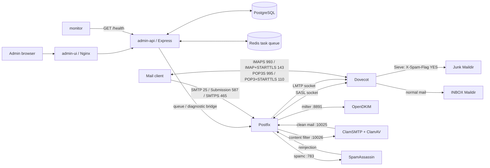
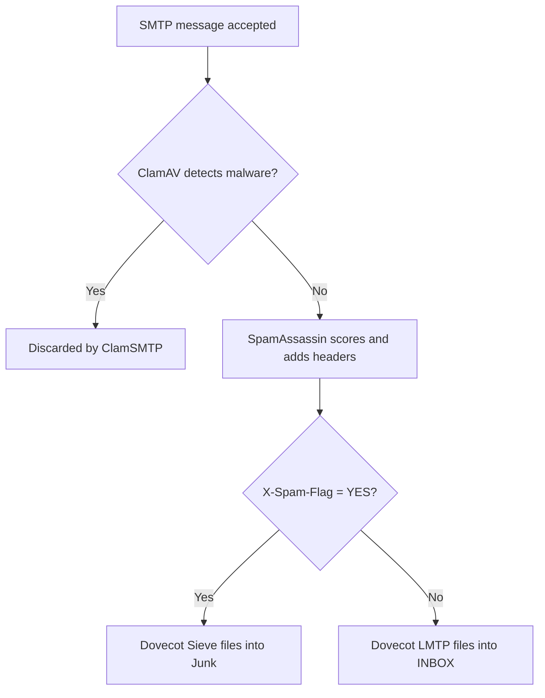

# Mail stack integration test report

**Run date:** 13 November 2026 (local environment)  
**Scope:** running Docker Compose stack, supplied `user@mail.local` and `test@mail.local` test accounts, and non-destructive configuration checks. No external mail was sent.

## Result

The active local mail path works end to end: authenticated submission, ClamAV scanning, SpamAssassin scoring, DKIM signing, LMTP delivery, and Dovecot/Sieve mailbox filing all passed. The expired local development certificate was replaced with a valid self-signed certificate. Rspamd is not enabled in the active Compose configuration and is not in the tested mail path.

## End-to-end service flow

### Message decisions

## Test matrix

| Area / combination | Result | Evidence |
|---|---|---|
| Compose interpolation and service graph | PASS | `docker compose config --quiet` exited 0. |
| Admin API unit suite | PASS | 4/4 suites passed: backup, queue, TOTP, validation. |
| PostgreSQL, Redis, API, UI | PASS | `pg_isready`, `redis-cli ping`, `/health` (200), UI (200), OpenAPI (200). |
| Postfix, Dovecot, SpamAssassin config validation | PASS | `postfix check`, `doveconf -n`, and `spamassassin --lint` all passed. |
| OpenDKIM config / process | PASS (configuration) | `opendkim -x /etc/opendkim.conf -n` exited successfully; milter is configured on Postfix. |
| OpenDKIM across the full delivery path | PASS | A real SMTP submission retained a `DKIM-Signature` in the delivered INBOX message after ClamAV and SpamAssassin processing. |
| SMTP submission + SASL (`user` -> `test`) | PASS | TLS submission authenticated; normal message queued then delivered to `test` INBOX. |
| SMTP submission + AV + spam + Sieve | PASS | GTUBE message was marked `X-Spam-Flag: YES`, retained `X-Virus-Scanned: ClamAV`, and appeared in `test` Junk. |
| SMTP submission + EICAR malware | PASS | ClamSMTP logged `Eicar-Signature FOUND` and `Virus Detected; Discarded Email`; no matching message reached `test`. |
| SMTP invalid password | PASS | Server returned `535 5.7.8 Authentication failed`. |
| SMTP authenticated sender spoof (`user` sends as `test`) | PASS | Server returned `553 5.7.1 ... not owned by user`. |
| IMAPS 993 (user) | PASS | Dovecot `LOGIN` succeeded. |
| IMAP STARTTLS 143 (test) | PASS | Dovecot `LOGIN` succeeded after STARTTLS. |
| POP3S 995 (test) | PASS | `USER` / `PASS` succeeded. |
| POP3 STARTTLS 110 (user) | PASS | `USER` / `PASS` succeeded after STARTTLS. |
| SMTPS 465 (test) | PASS | TLS SMTP `AUTH PLAIN` succeeded. |
| Mail queue after tests | PASS | `postqueue -p` reported an empty queue. |
| Monitor to API health check | PASS | Current monitor log reports API health as healthy. |
| Rspamd + Redis/mail flow | NOT RUN / FAILING | `rspamd` is commented out in `docker-compose.yml`; an orphan `mailserver-rspamd-1` container is stopped (exit 137) and its last logs show Redis connection/script errors. |
| External delivery, public DNS, PTR/SPF/DKIM/DMARC | NOT RUN | Requires a real verified domain, valid public certificate, DNS, and an explicitly authorized external recipient/relay. |

## Resolved during this run

1. **Expired local TLS certificate — resolved.** Added `infrastructure/tls/generate-dev-cert.sh`, regenerated `secrets/tls/cert.pem` and `privkey.key`, and restarted Postfix/Dovecot. The replacement certificate covers `mail.local`, `localhost`, `127.0.0.1`, and `::1` and is valid until 15 February 2029. It is deliberately self-signed for local development; a CA-issued certificate remains necessary for public use.
2. **Missing DKIM signatures — resolved.** OpenDKIM's dynamic maps were configured as plain paths, preventing runtime key/signing-table lookup. They now use explicit `refile:` declarations. The full SMTP → ClamAV → SpamAssassin → Dovecot test now delivers a message with a valid `rsa-sha256` `DKIM-Signature`.

## Explicitly excluded

- **Rspamd + Redis/mail flow:** Rspamd remains commented out of Compose and its orphan container remains stopped, by request.
- **External delivery, public DNS, PTR/SPF/DKIM/DMARC:** not tested or changed, by request. This requires a real verified domain, public DNS, a CA-issued certificate, and an authorized external recipient/relay.

## Test artefacts retained

Several harmless messages remain in `test@mail.local` for inspection, including:

- `integration-normal-20261113` in INBOX.
- `integration-gtube-20261113` in Junk (intentionally spam-tagged).
- `integration-dkim-fixed-20261113` in INBOX (the successful end-to-end DKIM verification).

The EICAR test message was intentionally not delivered. This run added the development certificate generator, corrected the OpenDKIM map configuration, and updated this report; it did not alter the excluded Rspamd or public-delivery areas.

## Coverage boundary

“All possible combinations” is not finite for a distributed mail system. This run covers each enabled transport, both supplied identities, the normal/spam/malware decision branches, key authentication failures, the active persistence services, and the API/UI health path. The two excluded areas are explicitly listed above rather than inferred as passing.
